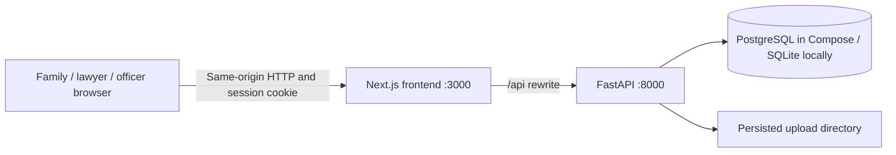

# Application architecture

Estate Unlock is a local, lawyer-led proof of concept for coordinating estate work. It persists collaboration and review actions while recording agency decisions, payments and institutional releases as simulations. Jurisdiction research is reference material; it is not an executable inheritance engine.

## Runtime and code map

| Location | Responsibility |
| --- | --- |
| `app/` | Next.js entry point, metadata and global styles |
| `components/estate-app.tsx` | Role workspaces, forms, navigation and application operations |
| `components/family-workspace.tsx` | Task-first family estate list and case overview |
| `components/ui.tsx` | Shared controls, dialogs, labels and journey presentation |
| `lib/api.ts` | Same-origin API client, shared types, formatting and BM/English dictionary |
| `next.config.ts` | `/api` proxy and local development origin configuration |
| `backend/main.py` | HTTP routes, role/case checks, workflow commands, uploads and summaries |
| `backend/models.py` | SQLAlchemy persistence model |
| `backend/security.py` | Password hashing, session verification and role checks |
| `backend/database.py` | Database connection, request session and data directory |
| `backend/seed.py` | Fictional dataset and destructive demo reset command |
| `backend/tests/`, `tests/browser_smoke.py` | API regression tests and connected browser walkthrough |
| `compose.yaml` | PostgreSQL, API and frontend containers with persistent volumes |

The frontend is a client application with hash-based navigation. Requests use a 30-second timeout and the browser's same-origin cookie. FastAPI checks permissions independently of which buttons the frontend displays. There is no background queue, email service, external identity provider or public API integration.

## Persisted entities

The implementation has nine SQL tables. Several conceptual entities share the typed `records` table rather than separate tables.

| Table / model | Purpose and relationships |
| --- | --- |
| `users` / `User` | Account identity, role and organisation string. Organisation is not a separate managed entity in this demo. |
| `sessions` / `Session` | Hashed session token, user reference and expiry. |
| `estates` / `Estate` | Case reference, deceased, jurisdiction, religion, stage, assigned lawyer and intake details JSON. |
| `memberships` / `Membership` | Unique estate/user pair plus coordinator flag; grants family access to that estate. |
| `intakes` / `Intake` | Applicant-owned saved facts, review status/reason and accepted estate reference. |
| `records` / `Record` | Estate-linked `person`, `asset`, `liability`, `task`, `query`, `hearing`, `decision`, `fee`, `note`, `activity` and `notification` records. Kind-specific data is JSON; handlers validate permitted operations. |
| `documents` / `Document` | File metadata, owner, visibility, review status and immutable file revision linked by `supersedes_id`. |
| `submissions` / `Submission` | Officer assignment, revision, status and fixed JSON snapshot of published evidence/inventory/responses. |
| `invitations` / `Invitation` | Random link token bound to email, estate, coordinator flag and acceptance state. |

File contents live under `DATA_DIR/uploads`, not in the SQL database. A revision creates a new file and row; file bytes are not overwritten. Review status/comment can change on the latest document row. A published submission keeps its snapshot and exact document IDs; later uploads are not published automatically. Officers can access documents in their assigned submission history, not just the latest submission.

## Authentication and access

Public registration always creates a family account. Lawyer/officer accounts are seeded. Passwords use salted `scrypt`; session tokens are random, only their SHA-256 hashes are stored, and the HTTP-only `estate_session` cookie expires after seven days. Cookies use `SameSite=Lax`; set `COOKIE_SECURE=true` for HTTPS. Logout deletes the server session and browser cookie.

| Boundary | Server rule |
| --- | --- |
| Family estate access | A matching `Membership` is required; registration alone grants no estate access. |
| Coordinator | Can update intake details and add people/assets/liabilities; ordinary members cannot. |
| Law firm | Assigned lawyer's organisation string must match the signed-in lawyer's organisation. |
| Officer | An application submission assigned to that officer is required. Submission inventory is shown instead of unpublished live inventory. |
| Private file | Owner and law firm can view it; other family members and officers cannot. The download route checks this again. |
| Professional note | Visible to the law firm only; excluded from submission snapshots. |
| Task response | Only the assigned person can respond; lawyer reviews/completes or reassigns unfinished tasks. |
| Invitation | Signed-in family email must match the invitation; repeated acceptance does not duplicate membership. |
| Browser writes | Requests with an `Origin` header outside `APP_ORIGINS` are rejected. This is a local-demo guard, not a complete production security assessment. |

Case activity records the actor, time and meaningful action; notifications are stored per recipient. This is application history, not an independently tamper-proof audit log. There is no email verification, password reset, MFA, session-management screen or organisation provisioning.

## Workflow and transition gates

Both entry paths converge on `Estate` plus family `Membership`: accepting intake copies its facts and links it to the new case; invitation acceptance joins a lawyer-created case. Repeated intake acceptance is rejected.

| State model | Implemented transitions / checks |
| --- | --- |
| Intake | `draft → submitted → information_requested → submitted`, or `accepted` / `declined`. Applicant edits only a draft or information-requested enquiry. Submission requires deceased name and confirmed facts. |
| Document | `uploaded`, `under_review`, `accepted` or `correction_requested`; lawyer reviews latest revision only. Correction requires a comment and creates an owner task. New uploads preserve the revision chain. |
| Task | `open → responded → completed`; completion requires a response. Reassignment is allowed before completion. Repeated completion is harmless. |
| Submission | `submitted → correction_requested`; resubmission creates a new revision. Only current accepted shared documents are included, with inventory and completed non-private query responses. |
| Agency query | `open → resolved`; officer must receive a submission newer than the queried revision before resolving. The demo does not semantically validate the adequacy of the response. |
| Asset | `identified → evidence_checked → claim_prepared → submitted → approved → released`; `submitted → query → submitted` is the correction branch. Claim preparation onward requires an issued order; release requires evidence text. |
| Fee | `estimated → paid`, recorded by lawyer and labelled simulated. |

`Estate.stage` maps to the six user-facing stages and a completion state:

| Stored value | Meaning | How it advances |
| --- | --- | --- |
| 0 | Prepare | New cases start here. |
| 1 | Legal review | Main seeded case starts here; there is no separate command to enter this value. |
| 2 | Submit / ready | `ready`: at least one asset and all current shared documents accepted. |
| 3 | Agency review | `submit`: readiness required; later resubmission requires an agency correction request and accepted current shared documents. |
| 4 | Order issued | `decision`: assigned officer records notes after all queries resolved and at least one simulated hearing recorded. |
| 5 | Asset release / implementation | `implement`: lawyer starts after order. |
| 6 | Completed | `complete`: all assets released with evidence and all tasks completed. Adding a newly discovered asset reopens stage 5. |

The six stages express handoffs, not a time estimate. There is no predictable percentage or remaining-duration calculation. Scheduling a hearing records an appointment; the app does not validate legal service, attendance or external hearing outcomes.

## Configuration and operations

See [README](../README.md) for exact startup commands and [demo guide](demo-guide.md) for reset/testing.

| Variable | Default / purpose |
| --- | --- |
| `DATABASE_URL` | Omit for local SQLite at `DATA_DIR/estate.db`; Compose sets PostgreSQL using psycopg. |
| `DATA_DIR` | `data`; stores SQLite file locally and uploaded files. Compose maps it to a persistent uploads volume. |
| `API_URL` | Next.js API rewrite destination; local default `http://127.0.0.1:8000`, Docker uses `http://api:8000`. Rebuild the frontend when changing a built rewrite destination. |
| `APP_ORIGINS` | Comma-separated permitted browser origins; default localhost and 127.0.0.1 on port 3000. |
| `COOKIE_SECURE` | `false` locally; `true` sends session cookie over HTTPS only. |
| `APP_URL`, `CHROMIUM_PATH` | Optional browser test target and executable override. |

Startup creates missing tables and seeds only an empty user database. The seed reset drops/recreates tables and restores fictional rows; it is not a migration, backup or uploaded-file cleanup system. Back up SQL and uploaded files together when preserving a demo. No schema migration framework, malware scanning, antivirus, backups, retention policy, concurrency stress testing or operational monitoring is implemented.

## Boundaries for extending the app

Keep official integration adapters separate from case collaboration. A real deployment needs verified legal routing, organisation membership management, database migrations, evidence scanning/encryption/retention, stronger account controls, review of transaction/concurrency behavior, and consent/accessibility testing with Malaysian families and professionals. This list describes implementation gaps, not services currently connected. The [verification record](verification.md) distinguishes completed tests from environment limits.
