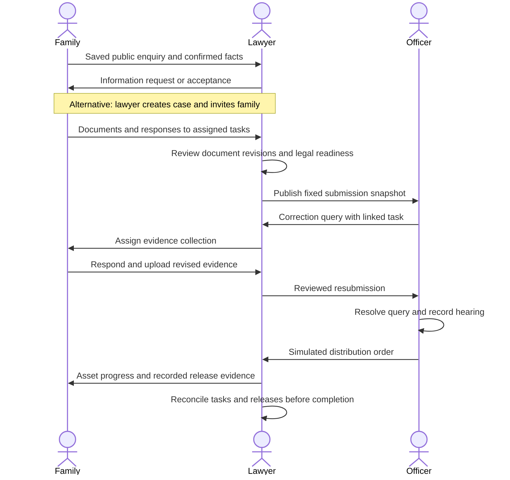

# Estate Unlock — implementation design

This local proof of concept follows the agreed lawyer-led design and `design-skill-command.md`. All people, documents and processing outcomes in the seed dataset are fictional.

## Service blueprint



## Permission matrix

| Capability | Coordinator | Family member | Law firm | Assigned officer |
| --- | --- | --- | --- | --- |
| View shared case summary | Yes | Yes | Yes | Submitted summary only |
| Add asset/person/liability | Yes | No | Yes | No |
| Upload shared/own private evidence | Yes | Yes | Yes | No |
| View another member's private document | No | No | Yes | No |
| Review document / readiness | No | No | Yes | No |
| Create invitations / submissions | No | No | Yes | No |
| Respond to task | Own only | Own only | Own only | No |
| Assign/review task | No | No | Yes | No |
| View firm notes | No | No | Yes | No |
| Raise/resolve agency query | No | No | No | Yes |
| Schedule hearing / issue simulated order | No | No | No | Yes |
| Record simulated fee payment / asset release | No | No | Yes | No |

Authentication role is separate from estate membership. Officers must have an assigned submission before opening a case. Private document content is checked again at the file-download endpoint. Published document contents are immutable: corrections create a new file and document ID.

## Screen map and wireframes

- Sign-in/register: contextual introduction, two entry paths, demo account credential launcher.
- Family: overview, assigned tasks, documents, assets, updates; enquiry wizard with draft saving.
- Law firm: dashboard, public enquiries, cases, notifications; case tabs for overview, people, inventory, documents, tasks, applications, fees, history.
- Agency: assigned-application queue, submitted documents, queries, hearings, simulated decisions, history.

```text
DESKTOP WORKSPACE
┌──────────────┬─────────────────────────────────────────────────┐
│ Brand        │ Workspace / Case              EN  Notifications │
│ Organisation ├─────────────────────────────────────────────────┤
│              │ Page title                         Primary task │
│ Navigation   │ Context / current status                        │
│              ├─────────────────────────────────────────────────┤
│              │ Section tabs                                    │
│              │ Journey: Prepare → Review → Submit → … → Release│
│              │ ACTION NEEDED: task / person / evidence / button │
│              ├────────────────────────────┬────────────────────┤
│              │ Asset inventory / evidence │ Case facts         │
│ Guidance     │                            │ Next appointment   │
│ Account      │ Dated activity history     │ Next legal action  │
└──────────────┴────────────────────────────┴────────────────────┘

DOCUMENT REVIEW
┌──────────────────────────────┬─────────────────────────────────┐
│ Original document preview    │ Revision / visibility / status  │
│                              │ Review comment                  │
│                              │ Accept / Request correction     │
│                              │ Upload new revision             │
└──────────────────────────────┴─────────────────────────────────┘

MOBILE FAMILY VIEW
┌─────────────────────────┐
│ Menu  Case       EN Bell│
│ Estate / current stage │
│ Scrollable section tabs│
│ Six-stage journey      │
│ Your next action       │
│ Assets and progress    │
│ Activity               │
│ Appointment and facts  │
└─────────────────────────┘
```

## State models

- Intake: draft → submitted → information requested → submitted → accepted / declined. Acceptance is single-use and retains confirmed facts.
- Documents: uploaded → under review → accepted / correction requested. New revision points to the previous immutable file.
- Tasks: open → responded → completed. Only assignee responds; law firm reviews completion and can reassign unfinished requests.
- Case: prepare / legal review → ready to submit → agency review → order issued → asset implementation → completed.
- Submission: submitted → correction requested → new submission revision; order issued on the latest revision after queries are resolved and a hearing recorded.
- Assets: identified → evidence checked → claim prepared → submitted → query / approved → released. Queries return to submitted; release requires a recorded evidence reference.

## User stories and acceptance criteria

| User story | Screen / operation | Observable acceptance criterion |
| --- | --- | --- |
| As a family coordinator, I can ask for help before I have a lawyer. | Public registration → enquiry wizard → enquiry review | Saved drafts survive reload; acceptance creates one estate retaining the confirmed intake facts. |
| As an existing lawyer, I can bring my client into a case. | New case → People → invitation → authenticated acceptance | Only the invited email can accept; acceptance adds case membership without a second intake. |
| As a family member, I can safely supply my evidence. | Documents → upload / new revision | Another family member cannot read my private file, including through its direct download URL. |
| As a lawyer, I can correct evidence before publication. | Document review → correction request → task → accepted revision | The family sees the request, responds, and the lawyer records review; the earlier revision remains available. |
| As an officer, I review a stable application. | Applications → submitted documents | New family uploads remain invisible until the lawyer publishes a resubmission; earlier submission snapshots remain available. |
| As a lawyer, I can coordinate an agency query. | Queries → linked task → reassignment → response → resubmission | The request has an owner and response; the officer can read the published response and resolve the query. |
| As an officer, I can record a simulated outcome. | Hearing → Decision | A hearing and resolved queries are required before issuing an order; private lawyer notes stay inaccessible. |
| As a family, we can see work remaining after the order. | Overview → Assets | The order opens asset implementation; completion is rejected until every asset has release evidence and outstanding tasks are completed. |
| As any user, I can return to my work. | Sign-in → role workspace | Server-side sessions, uploads, responses and dated activity persist; unrelated accounts receive access errors. |
| As a demo presenter, I can repeat the scenario. | Seed reset command | The original fictional estate, users, evidence and tasks are restored without manually rebuilding the workflow. |

The automated browser walkthrough validates the connected journeys at desktop size and checks the family overview at a 390px mobile width. API tests exercise the permission failures and state-transition gates independently of the UI.

## Design foundation

System fonts and restrained navy/teal establish a calm service workspace. Translucent navigation and modal chrome establish depth; solid document surfaces preserve readability. The main actionable request dominates family case views. Professional views use compact queues and split review panels.

Motion uses interruptible no-bounce springs for route/modal arrival; CSS press feedback starts immediately. There are no mandatory gestures, autoplay sound or decorative looping motion. Focus is trapped in dialogs and restored on exit. Motion, transparency and contrast preferences have explicit CSS handling.

## Prototype limits

One law firm receives public enquiries; this is not a marketplace. One simulated JKPTG office receives submissions. Invitations use copyable links rather than outbound email. BM/EN navigation and common actions are translated; fictional case content and detailed explanations are currently English. Assisted extraction is a deterministic, labelled fictional example. Jurisdiction strings can be recorded but do not activate additional legal rules. There is no legal share calculator. Uploaded files and sessions persist across reloads; no official service is contacted.
