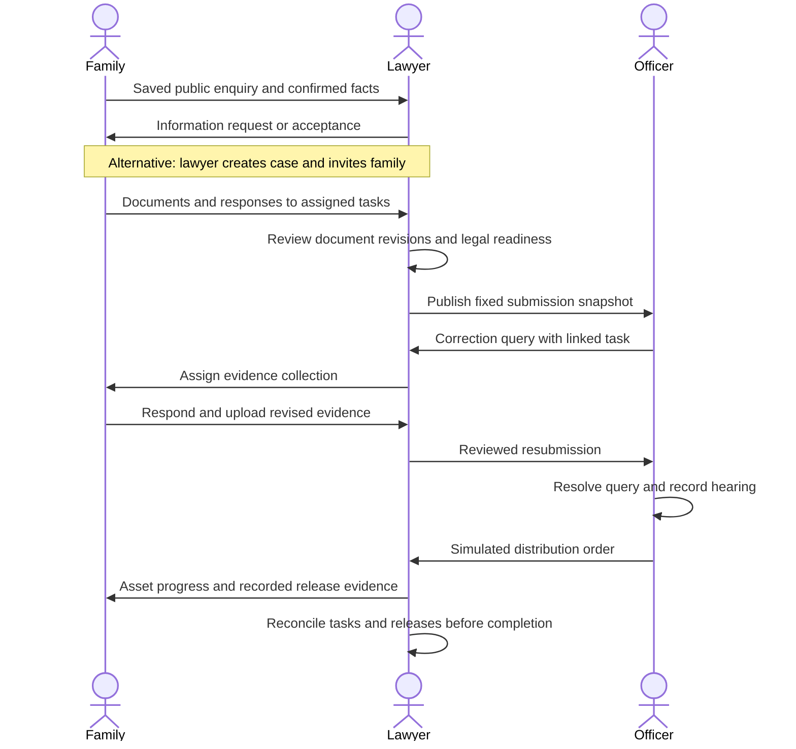

# Estate Unlock — implementation design

This local proof of concept follows the agreed lawyer-led workflow. Its interface prioritises the next task, is informed by MYDS principles and uses familiar public-service patterns from GOV.UK, with W3C accessibility targets and restrained feedback from `design-skill-command.md`. See [UI guidelines and primary sources](ui-guidelines.md), [architecture](architecture.md), [API operations](api.md) and [demo guide](demo-guide.md). All people, documents and processing outcomes in the seed dataset are fictional.

## Service blueprint



## Permission matrix

| Capability | Coordinator | Family member | Law firm | Assigned officer |
| --- | --- | --- | --- | --- |
| View shared case summary | Yes | Yes | Yes | Submitted summary only |
| Add asset/person/liability | Yes | No | Yes | No |
| Upload shared/own private evidence | Yes | Yes | Yes | No |
| View another member's private document | No | No | Yes | No |
| Review document / readiness | No | No | Yes | No |
| Create invitations / submissions | No | No | Yes | No |
| Respond to task | Own only | Own only | Own only | No |
| Assign/review task | No | No | Yes | No |
| View firm notes | No | No | Yes | No |
| Raise/resolve agency query | No | No | No | Yes |
| Schedule hearing / issue simulated order | No | No | No | Yes |
| Record simulated fee payment / asset release | No | No | Yes | No |

Authentication role is separate from estate membership. Officers must have an assigned submission before opening a case. Private document content is checked again at the file-download endpoint. Published document contents are immutable: corrections create a new file and document ID.

## Screen map and wireframes

- Sign-in/register: simple form, clear family registration link, invitation acceptance and optional demo-account shortcuts.
- Family: global navigation has Your estates and Updates. Estate cards show task count and one View estate action; saved enquiries can be resumed. Inside a case, wrapped navigation links to Overview, My tasks, Documents, Assets and Updates. The overview leads with next action/actor, shows an appointment only when scheduled, and keeps full process stages and family facts in named disclosures.
- Law firm: work queue, public enquiries, cases and notifications; case sections retain people, inventory, documents, tasks, applications, fees and history without decorative dashboard panels.
- Agency: assigned-application queue, submitted documents, queries, hearings, simulated decisions and history. Publication boundaries and revision history remain visible during review.

These wireframes describe information priority, not a pixel specification. Case sections use ordinary wrapped navigation with a current-page indicator, rather than horizontally scrolling tabs. Optional disclosures must not hide required actions or relevant appointments. Sign-in is one column; Try a demo account expands the credential launcher.

```text
PROFESSIONAL WORKSPACE
┌──────────────┬─────────────────────────────────────────────────┐
│ Brand        │ Workspace / Case              EN  Notifications │
│ Organisation ├─────────────────────────────────────────────────┤
│              │ Page title                         Primary task │
│ Navigation   │ Context / current status                        │
│              ├─────────────────────────────────────────────────┤
│              │ Relevant queue or selected case section         │
│              │ NEXT ACTION: task / person / evidence / button   │
│              ├────────────────────────────┬────────────────────┤
│              │ Focused review / inventory │ Needed case facts  │
│ Guidance     │ or submitted evidence      │ Next appointment   │
│ Account      │ More context on request    │ Revision / status  │
└──────────────┴────────────────────────────┴────────────────────┘

DOCUMENT REVIEW
┌──────────────────────────────┬─────────────────────────────────┐
│ Original document preview    │ Revision / visibility / status  │
│                              │ Review comment                  │
│                              │ Accept / Request correction     │
│                              │ Upload new revision             │
└──────────────────────────────┴─────────────────────────────────┘

MOBILE FAMILY VIEW
┌─────────────────────────┐
│ Menu  Case       EN Bell│
│ Estate / current stage │
│ What you need to do    │
│ Request / owner        │
│ [One main action]      │
│ Next appointment*      │
│ Tasks Documents Assets │
│ > Full process detail  │
│ > More case context    │
└─────────────────────────┘
* When scheduled
```

## State models

- Intake: draft → submitted → information requested → submitted → accepted / declined. Acceptance is single-use and retains confirmed facts.
- Documents: uploaded → under review → accepted / correction requested. New revision points to the previous immutable file.
- Tasks: open → responded → completed. Only assignee responds; law firm reviews completion and can reassign unfinished requests.
- Case: prepare / legal review → ready to submit → agency review → order issued → asset implementation → completed.
- Submission: submitted → correction requested → new submission revision; order issued on the latest revision after queries are resolved and a hearing recorded.
- Assets: identified → evidence checked → claim prepared → submitted → query / approved → released. Queries return to submitted; release requires a recorded evidence reference.

## User stories and acceptance criteria

| User story | Screen / operation | Observable acceptance criterion |
| --- | --- | --- |
| As a family coordinator, I can ask for help before I have a lawyer. | Public registration → enquiry wizard → enquiry review | Saved drafts survive reload; acceptance creates one estate retaining the confirmed intake facts. |
| As an existing lawyer, I can bring my client into a case. | New case → People → invitation → authenticated acceptance | Only the invited email can accept; acceptance adds case membership without a second intake. |
| As a family member, I can safely supply my evidence. | Documents → upload / new revision | Another family member cannot read my private file, including through its direct download URL. |
| As a lawyer, I can correct evidence before publication. | Document review → correction request → task → accepted revision | The family sees the request, responds, and the lawyer records review; the earlier revision remains available. |
| As an officer, I review a stable application. | Applications → submitted documents | New family uploads remain invisible until the lawyer publishes a resubmission; earlier submission snapshots remain available. |
| As a lawyer, I can coordinate an agency query. | Queries → linked task → reassignment → response → resubmission | The request has an owner and response; the officer can read the published response and resolve the query. |
| As an officer, I can record a simulated outcome. | Hearing → Decision | A hearing and resolved queries are required before issuing an order; private lawyer notes stay inaccessible. |
| As a family, we can see work remaining after the order. | Overview → Assets | The order opens asset implementation; completion is rejected until every asset has release evidence and outstanding tasks are completed. |
| As any user, I can return to my work. | Sign-in → role workspace | Server-side sessions, uploads, responses and dated activity persist; unrelated accounts receive access errors. |
| As a demo presenter, I can repeat the scenario. | Seed reset command | The original fictional estate, users, evidence and tasks are restored without manually rebuilding the workflow. |

The automated browser walkthrough validates the connected journeys at desktop size and checks the family overview at a 390px mobile width. API tests exercise the permission failures and state-transition gates independently of the UI.

## Design foundation

[MYDS design principles](https://design.digital.gov.my/en/docs/design), the [centred login template](https://design.digital.gov.my/en/docs/develop/login) and [accessibility guidance](https://design.digital.gov.my/en/docs/develop/accessibility) provide the local reference for simplicity, consistency and inclusive controls (accessed 21 October 2026). Estate Unlock is informed by these principles; it keeps its existing component implementation, system fonts and own branding. It does not claim full MYDS compliance or represent an official government service.

The interface follows [task lists](https://design-system.service.gov.uk/components/task-list/), [clear primary actions](https://design-system.service.gov.uk/components/button/) and [optional details](https://design-system.service.gov.uk/components/details/) from the GOV.UK Design System (accessed 21 October 2026). Family pages answer: where are we, what do I need to do, who acts next and what remains? Start with current stage and next task. Keep detailed journey/history available without displaying every section at once. Essential corrections, appointments and remaining asset work stay visible.

System fonts, restrained navy accents, solid light surfaces and subtle borders support scanning. Professional views keep useful queues and split evidence review. Decorative hero sections, repeated metric cards and competing filled buttons should not dominate working screens. Explain legal terms in the task context and use action-specific button labels. Plain, readable service patterns take precedence over decorative effects when applying the repo's design skill.

Immediate press/pending feedback remains useful. Motion should be brief, optional and respect reduced-motion preferences; no gesture or animation is required to understand the process. Dialogs keep focus contained and restore it on exit. Visible labels, keyboard focus, contrast and mobile reflow are review targets documented in [UI guidelines](ui-guidelines.md), not a claim of a completed WCAG audit.

## Prototype limits

One law firm receives public enquiries; this is not a marketplace. One simulated JKPTG office receives submissions. Invitations use copyable links rather than outbound email. BM/EN navigation and common actions are translated; fictional case content and detailed explanations are currently English. Assisted extraction is a deterministic, labelled fictional example. Jurisdiction strings can be recorded but do not activate additional legal rules. There is no legal share calculator. Uploaded files and sessions persist across reloads; no official service is contacted.
